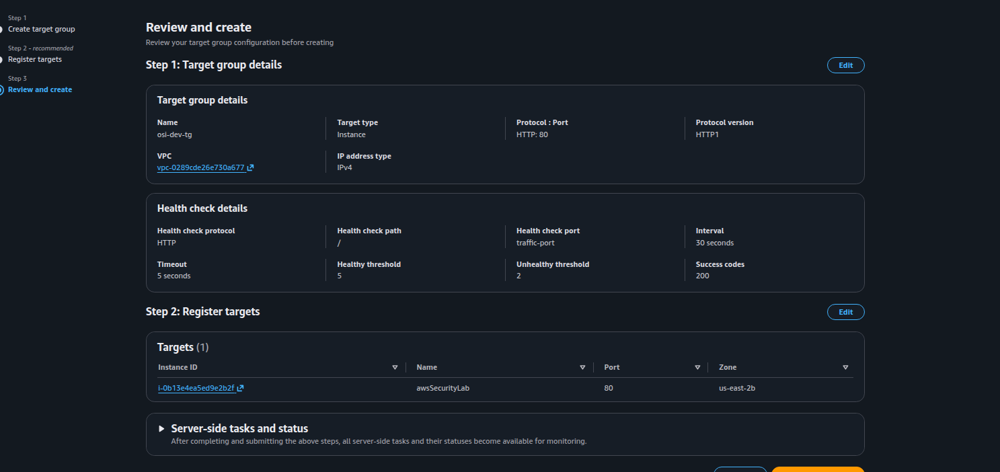
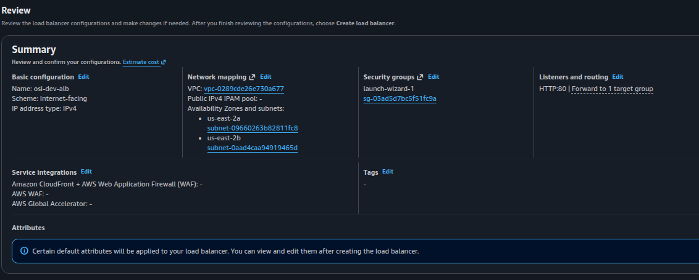

# OSI Dev Explorer - AWS ALB & Target Group Configuration

## 🇪🇸 Versión en Español

### 1. Resumen de la Arquitectura
- **Entorno:** AWS EC2 (`t3.medium`) ejecutando contenedores Docker.
- **Punto de Entrada:** Application Load Balancer (ALB) orientado a Internet.
- **Estrategia de Red:** El ALB recibe el tráfico público y lo reenvía a la instancia EC2.

### 2. Configuración del Grupo de Destino (Target Group)
- **Nombre:** `osi-dev-tg`
- **Tipo de destino:** Instancias (*Instances*)
- **Protocolo / Puerto:** HTTP / 80
- **VPC:** `vpc-0289cde26e730a677` (Default)
- **Instancia Asociada:** `awsSecurityLab` (`i-0b13e4ea5ed9e2b2f`) en el puerto 80

### 3. Configuración del Application Load Balancer (ALB)
- **Nombre:** `osi-dev-alb`
- **Esquema:** Orientado a Internet (*Internet-facing*)
- **Tipo de IP:** IPv4
- **Mapeo de Red:** VPC por defecto en las Zonas de Disponibilidad `us-east-2a` y `us-east-2b`
- **Grupo de Seguridad:** `launch-wizard-1` (`sg-03ad5d7bc5f51fc9a`)
- **Escuchadores (Listeners):**
  - **HTTP (Puerto 80):** Reenvía (*Forward to*) a `osi-dev-tg`

---

## 🇬🇧 English Version

### 1. Architecture Overview
- **Environment:** AWS EC2 (`t3.medium`) running Docker containers.
- **Entry Point:** Internet-facing Application Load Balancer (ALB).
- **Network Strategy:** ALB handles public traffic and forwards requests to the EC2 instance.

### 2. Target Group Configuration
- **Name:** `osi-dev-tg`
- **Target Type:** Instances
- **Protocol / Port:** HTTP / 80
- **VPC:** `vpc-0289cde26e730a677` (Default)
- **Registered Target:** `awsSecurityLab` (`i-0b13e4ea5ed9e2b2f`) on port 80

### 3. Application Load Balancer (ALB) Configuration
- **Name:** `osi-dev-alb`
- **Scheme:** Internet-facing
- **IP Address Type:** IPv4
- **Network Mapping:** Default VPC across `us-east-2a` and `us-east-2b` Availability Zones
- **Security Group:** `launch-wizard-1` (`sg-03ad5d7bc5f51fc9a`)
- **Listeners:**
  - **HTTP (Port 80):** Forwards to `osi-dev-tg`

  
