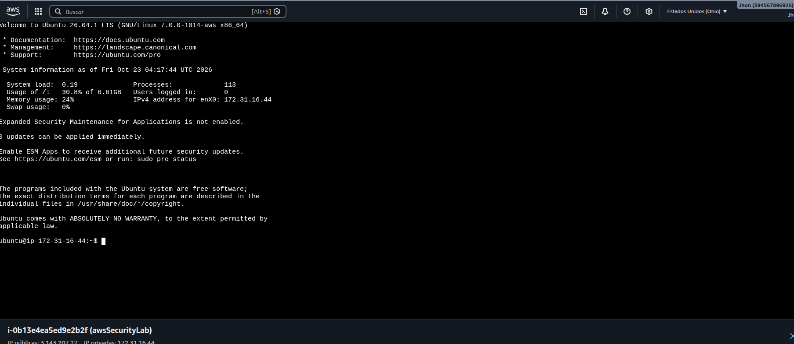
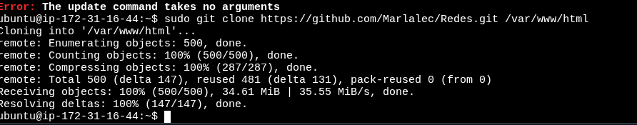

# 🚀 EC2 Setup & Docker Deployment Guide / Guía de Configuración EC2 y Despliegue con Docker

[🇪🇸 Español](#español) | [🇺🇸 English](#english)

---

<a name="español"></a>
## 🇪🇸 Español

### 1. Conexión Inicial a la Instancia AWS EC2
Se estableció la conexión remota al servidor Ubuntu Server LTS en AWS EC2, validando la información del sistema operativo y la dirección IP privada asignada (`172.31.16.44`).



### 2. Clonación del Repositorio del Proyecto
Se descargó y clonó el código fuente directamente desde el repositorio oficial de GitHub (`https://github.com/Marlalec/Redes.git`) hacia la ruta del servidor web (`/var/www/html`).



### 3. Configuración de Variables de Entorno y Docker Compose
Para inicializar la arquitectura de contenedores, se configuró el archivo de variables de entorno asignando la contraseña requerida (`CAMERA_PASSWORD=Admin123`) y se ejecutó el despliegue con Docker Compose:

```bash
sudo cp .env.example .env
echo "CAMERA_PASSWORD=Admin123" | sudo tee -a .env
sudo docker compose up -d